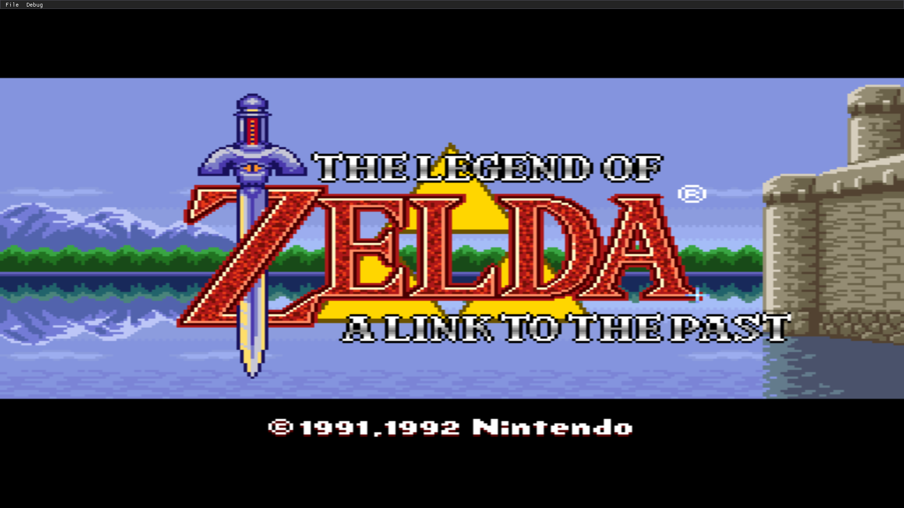
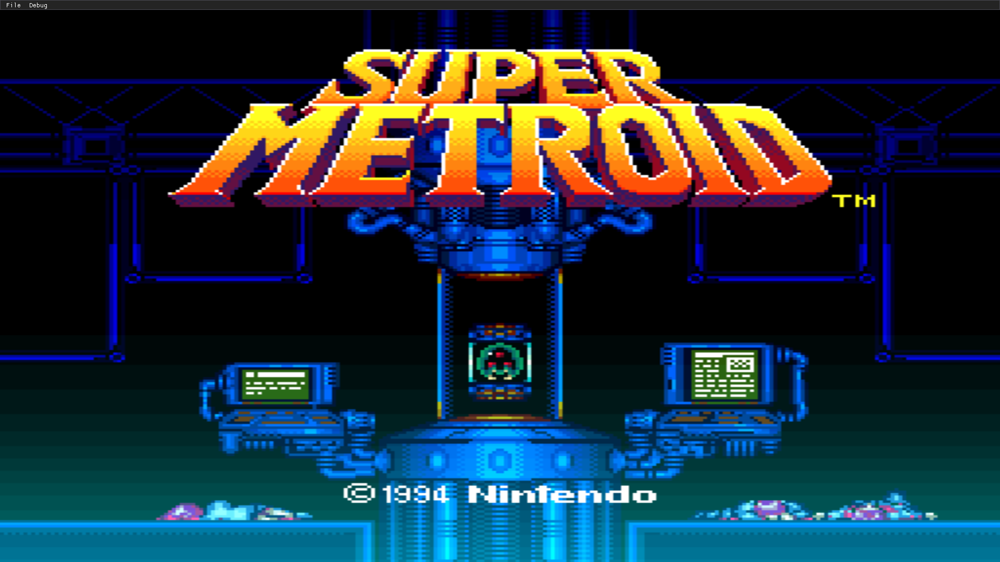

🎮 SupaNES
================

A Super Nintendo Entertainment System (SNES) emulator built from scratch in C++.

## 📸 Screenshots

## ✨ Features
- [x] Project initialization
- [x] CPU emulation (Ricoh 5A22)
- [x] Memory management and memory mapping
- [x] PPU (Picture Processing Unit) emulation
- [x] APU (Audio Processing Unit) emulation
- [x] ROM loading
- [x] Graphics rendering
- [x] Audio output

## 🛠️ Technologies
Language: C++

Build System: CMake

Graphics: SDL3

Audio: SDL3

## 📋 To-Do / Roadmap

### Graphics
- [ ] Per-tile offset

### Audio
- [ ] Echo

### Input
- [ ] Controller support
- [ ] Configurable controls

### Quality of Life
- [ ] ROM browser
- [ ] Save states
- [ ] Debugging tools
